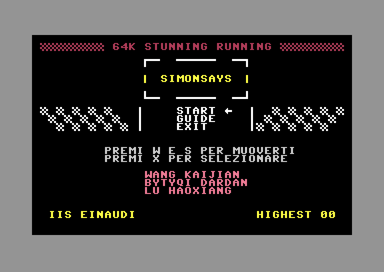
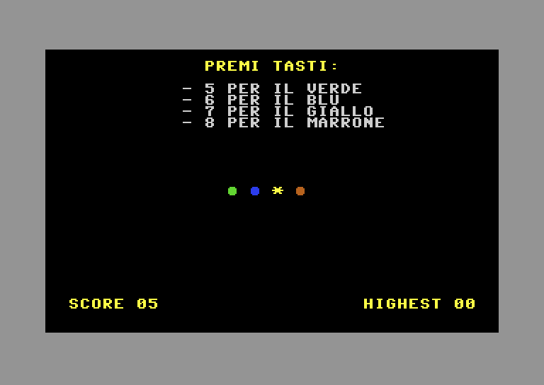
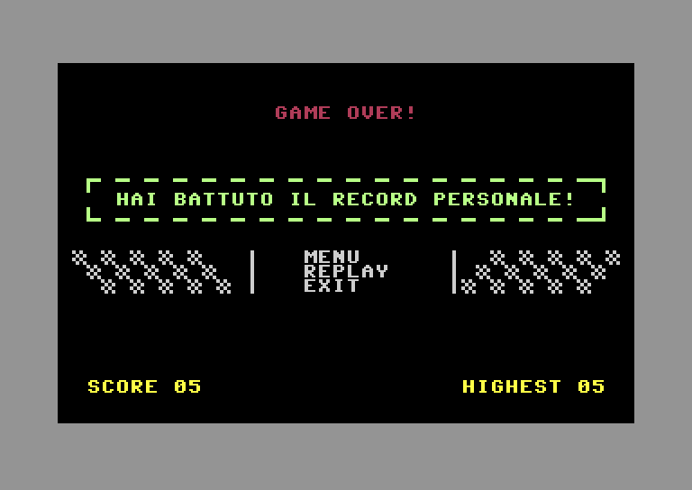

# SimonSays

A Simon Says game for the Commodore 64, written in BASIC V2.
Made in 2023 by the group **ExCo** from IIS Einaudi for **64K Stunning Running**, a programming competition run by the University of Verona.

**[▶ Play it in the browser](https://dardanbytyqi.github.io/SimonSays/)**

<p>
  
  
  
</p>

## How to play

| Key | Action |
| --- | --- |
| `W` / `S` | Move through the menu |
| `X` | Select, start a round |
| `5` `6` `7` `8` | Green, blue, yellow, brown |

The score and your best score for the session are shown at the bottom of the screen.

## Run it

Open the disk image in [VICE](https://vice-emu.sourceforge.io/), or in any other C64 emulator:

```bash
x64sc simonsays.d64
```

Or drag `simonsays.prg` into an emulator that autostarts programs.

## Files

| File | Content |
| --- | --- |
| `simonsays.bas` | Source listing, readable with any text editor |
| `simonsays.prg` | The tokenized program, as stored on the disk |
| `simonsays.d64` | 1541 floppy disk image with the program |

`simonsays.bas` is in [petcat](https://vice-emu.sourceforge.io/vice_16.html) format, so it converts back to the program with:

```bash
petcat -w2 -o simonsays.prg -- simonsays.bas
```

## Credits

Wang Kaijian, Dardan Bytyqi, Lu Haoxiang.
